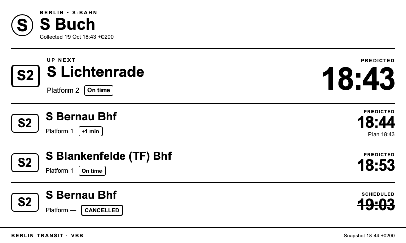
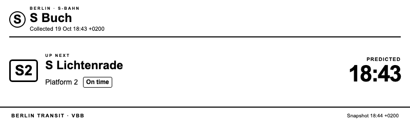
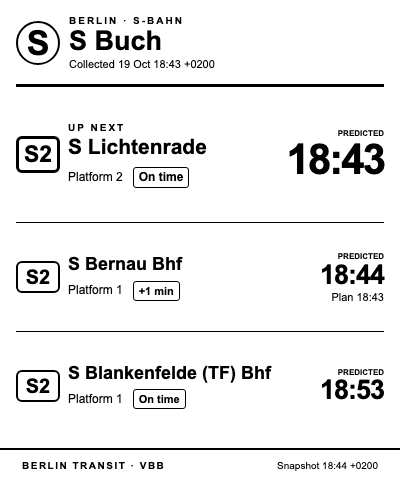
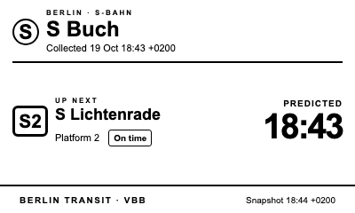

# berlin-transit

A small, display-independent public transport collector and private JSON API in Go.
Search VBB stations and fetch normalized departures using the CLI or the explicit
`serve` command. The HTTP API supports one or several stations.
S-Bahn (`suburban`) is the default mode. Station IDs are opaque strings; no station
is hardcoded. There is no telemetry. Periodic collection and TRMNL publishing
are optional and disabled by default.

Requires Go **1.27.2**, verified against the [official stable release feed](https://go.dev/dl/?mode=json)
on 2026-10-19. The module uses only the Go standard library and bundled timezone
data, with no external Go runtime dependencies. Consequently
there is no `go.sum`. The Go directive selects the verified patched minimum;
use the latest patched stable Go for development.

```sh
make check
make build
./dist/berlin-transit stations -query Alexanderplatz -limit 5
# Copy an ID from search into the next command:
./dist/berlin-transit departures -station 900100003 -limit 10 -duration 30
```

To start the private HTTP API, run this explicitly in a separate terminal:

```sh
./dist/berlin-transit serve
# From another terminal:
curl http://127.0.0.1:8080/healthz
curl 'http://127.0.0.1:8080/api/v1/stations?query=Alexanderplatz&limit=5'
curl 'http://127.0.0.1:8080/api/v1/stations/900100003/departures?mode=suburban&limit=5'
# Multi-station: inspect each result for data or an error (including rate limits):
curl 'http://127.0.0.1:8080/api/v1/departures?stations=900100003,900003201&limit=5'
```

The service allows 30 upstream requests/minute by default with burst one, so
separate cache misses within two seconds can return `429`. Respect `Retry-After`.
Cached queries do not consume upstream budget. `serve` binds only to literal
loopback IPs; wildcard and LAN/public addresses are rejected. Metrics are
disabled by default. Stop with Ctrl+C for graceful shutdown. See
[API, configuration and cache semantics](docs/api.md) for all endpoints and bounds.

CLI queries and uncached API queries call the configured third-party VBB HTTPS
upstream. CLI queries open no listening socket; `serve` explicitly opens the
loopback listener. CLI results stay on stdout unless the operator redirects
them; service logs are structured JSON on stderr. Automated tests use local mock servers and need no VBB
access. GitHub Actions test and build the collector and a local container image;
they never publish images, create releases, or deploy anything. See
[CI and security checks](docs/ci.md) for tools, coverage and artifact retention.

Departures accept `-mode` (`suburban`, `subway`, `tram`, `bus`, `ferry`, `express`,
`regional`) and `-direction` (a provider stop ID, not destination text). Search
text is limited to 200 bytes, IDs to 256 bytes, results to 1–50 and duration to
1–120 minutes. Missing required inputs fail before any upstream request.

`BERLIN_TRANSIT_HTTP_TIMEOUT` defaults to `10s` and must be between `1ms` and
`1m`. `BERLIN_TRANSIT_VBB_BASE_URL` defaults to `https://v6.vbb.transport.rest`;
only that exact HTTPS origin is accepted (an optional trailing slash is allowed).
There is no production development override. Environment variables configure
transport; command flags configure queries, so their settings do not overlap.
The client disables proxies and redirects, rejects private DNS answers and dials
validated IPs directly. Responses are capped at 2 MiB with bounded connections.
Errors omit search text, URLs, and upstream payloads. Interrupt/termination
signals cancel the request. There are no credentials.

JSON uses RFC3339 times in `Europe/Berlin`, including DST offsets. Unknown
times, delay, platform, line, direction, station name and provenance are `null`.
Known zero delay is preserved. `predicted_at` requires both `when` and a known
delay and is absent for cancellations; a timetable `when` alone does not prove
realtime. `realtime` means at least one returned departure has a prediction.
The upstream update timestamp is exposed separately as `realtime_updated_at`.
`fetched_at` records the last successful fetch or conditional revalidation.
The API marks eligible cached responses `stale` during transient failures,
includes `last_success_at` and `stale_age_seconds`, and sets `realtime=false`.
CLI queries do not use the cache. An empty departures result keeps the requested
ID with a null name.

The [VBB REST wrapper](https://v6.vbb.transport.rest/) is an unofficial third-party
service. Availability, terms and attribution requirements can change; it is not
a guarantee of realtime accuracy. Consult its [API documentation](https://v6.vbb.transport.rest/api.html).
Avoid polling aggressively; the documented upstream limit is 100 requests/minute.
CLI queries make one request per command. The persistent service shares its
upstream budget across searches, departures and at most two retries. It caches
searches for up to 24 hours and departures for up to 30 seconds, honors upstream
cache restrictions and supports ETags. Periodic polling requires explicit collector opt-in.

See [architecture and verification notes](docs/architecture.md) and the
[design](docs/design/berlin-transit-design.md). M1 and M2 are implemented, with
quality gates from M3 included. M4 adds multi-station HTTP queries (up to five
stations), sharing the existing cache and budget with explicit partial errors.
M5 adds optional scheduled collection and a disabled-by-default
[TRMNL webhook adapter with virtual-device testing](integrations/trmnl/README.md).
Run `make trmnl-package` to build the local import ZIP. Optional private deployment
examples remain deferred.
No deployment, image publication or release is authorized. TRMNL transmission
requires explicit local configuration and `TRMNL_ENABLED=true`.

## TRMNL (optional)

Display cached departures on a TRMNL private plugin or virtual device, using an
outbound webhook. Periodic collection and publishing are disabled by default;
the core API remains independent of the display. No public endpoint is needed.



*Full-screen layout with synthetic S Buch / S2 data. These screenshots illustrate
the design and are not live departure information.*

1. Run `make trmnl-package` and import `dist/berlin-transit-trmnl.zip` as a private
   plugin with **Webhook** strategy in your TRMNL account.
2. Run `./scripts/test-trmnl.sh`. The helper builds the binary, asks for the
   webhook URL with input hidden, and enables S-Bahn collection and delivery for
   **S Buch (Berlin), S2**, station `900135001`. This explicitly opts in to VBB
   queries and sending selected departure data to TRMNL.
3. Allow up to five minutes for `trmnl_sent`, then preview the plugin. Plugin and
   device refresh run on their own schedule. Stop the local test with Ctrl+C.

To query another station, pass its ID: `./scripts/test-trmnl.sh 900100003`.
Keep the webhook URL local; do not put it in Git, screenshots or command arguments.
To update an existing plugin, replace its layout tabs in **Edit Markup** and
Save, preserving the current webhook.

<details>
<summary>Half-screen and quadrant screenshots</summary>

**Half horizontal — 800 × 240**



**Half vertical — 400 × 480**



**Quadrant — 400 × 240**



</details>

See the [TRMNL setup and virtual-device testing guide](integrations/trmnl/README.md)
for configuration, quotas, stale-data behavior and troubleshooting. Collection
and snapshot timestamps stay visible: a screen can remain displayed after data
or connectivity expires. This is a departure snapshot, not a realtime guarantee.
